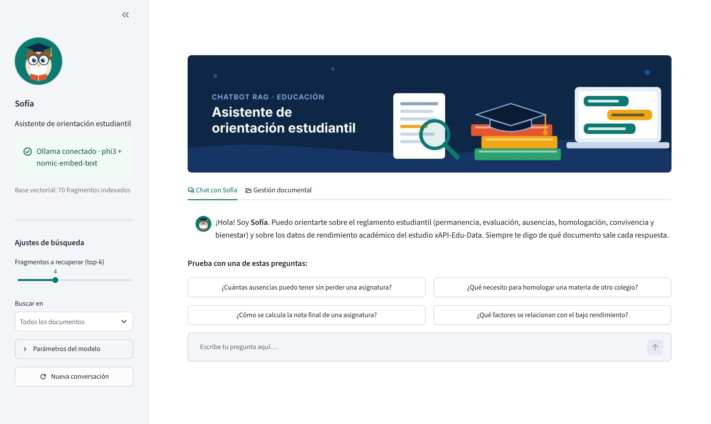
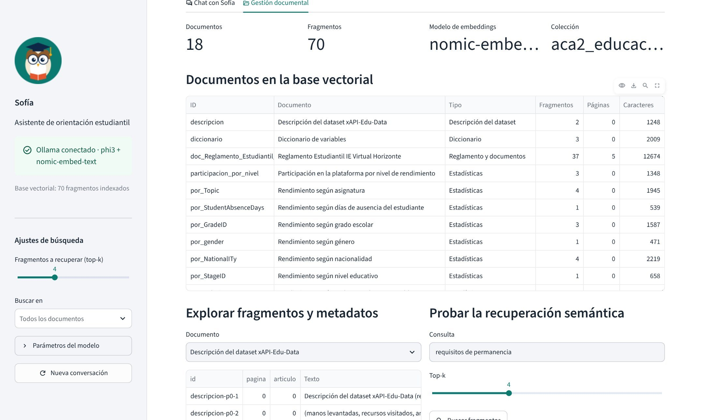
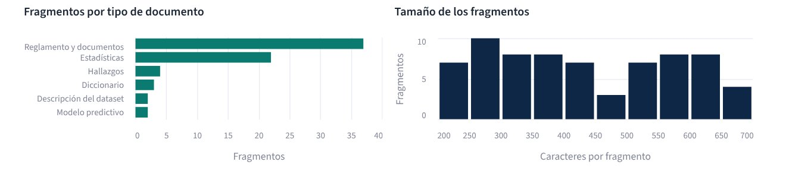

# Sofía · Chatbot RAG de orientación estudiantil


Chatbot con **Generación Aumentada por Recuperación (RAG)** que responde preguntas sobre un reglamento estudiantil
y sobre los datos de rendimiento académico **xAPI-Edu-Data**, citando siempre el documento, el artículo y la página
de donde sale cada dato. Funciona 100 % en local con **Ollama**, una base vectorial **Chroma** persistente y una
interfaz en **Streamlit** con chat, gestión documental y monitoreo.

**ACA 2 · Computación en la Nube · CUN** · Pilar: **Proyecto 2 – Educación**
Integrantes: [Nombre 1] · [Nombre 2] · [Nombre 3]

---

## Funcionalidades

| Módulo | Qué permite |
|---|---|
| **Chat con Sofía** | Conversación con historial, preguntas sugeridas, citas numeradas `[n]` con documento, artículo y página, relevancia de cada fuente y tiempos de respuesta. Ajuste de top-k y filtro por tipo de documento. |
| **Gestión documental** | Documentos indexados, explorador de fragmentos y metadatos, prueba de búsqueda semántica, carga de PDF/TXT, eliminación de documentos y reconstrucción del índice. |
| **Monitoreo** | Estado del índice (fragmentos por tipo, tamaño de los fragmentos, fecha y modelo de indexación) y métricas de uso: consultas, latencia media y p95, relevancia, porcentaje de respuestas con cita, abstenciones y documentos más citados. El registro se puede descargar en CSV. |

| Chat | Gestión documental |
|---|---|
|  |  |



## Arquitectura

```
                    INDEXACIÓN (una vez)
 Reglamento PDF ─┐
 CSV xAPI-Edu ───┼─► corpus.py ─► fragmentos ─► nomic-embed-text ─► Chroma (chroma_db/)
 Métricas MLP ───┘   (1 por artículo)          (Ollama)              persistente, coseno

                    CONSULTA (cada pregunta)
 Streamlit ─► embedding de la pregunta ─► top-k en Chroma ─► prompt (reglas + contexto numerado + historial)
     ▲                                                                   │
     └──────── respuesta con citas [n], fuentes y tiempos ◄── phi3 (Ollama local)
```

| Componente | Tecnología |
|---|---|
| Modelo de lenguaje | `phi3` en Ollama (local) · temperatura 0,2 |
| Embeddings | `nomic-embed-text` en Ollama (local) |
| Base vectorial | Chroma persistente en disco, distancia coseno |
| Orquestación | LangChain |
| Interfaz | Streamlit |
| Configuración | Variables de entorno en `.env` (python-dotenv) |

## Estructura del repositorio

```
├── app.py                        # Interfaz Streamlit: chat, gestión documental y monitoreo
├── rag_core.py                   # Configuración, Chroma, Ollama, prompt, canalización RAG y registro de consultas
├── corpus.py                     # Construcción del corpus: CSV, métricas del modelo y PDF de docs/
├── construir_indice.py           # Script: crea o reconstruye la base vectorial
├── evaluacion.py                 # Métricas de validación (paso 5)
├── verificar_entorno.py          # Script: diagnóstico de Python, librerías, Ollama, modelos e índice
├── ACA2_RAG_Ollama_Educacion.ipynb   # Notebook técnico con los pasos 1 a 5
├── CHAT_ACA1_base.py             # Código base del ACA 1 (referencia)
├── requirements.txt
├── .env.example                  # Plantilla de configuración (copiar como .env)
├── .streamlit/config.toml        # Tema visual de la app
├── data/                         # xAPI-Edu-Data.csv y métricas del modelo MLP
├── docs/                         # Reglamento estudiantil y otros documentos a indexar
├── pruebas/casos_prueba.csv      # 19 casos de prueba
├── assets/                       # Portada, avatares y capturas
└── herramientas/generar_reglamento.py  # Genera el PDF del reglamento ficticio
```

Carpetas que se crean al ejecutar y no se suben a GitHub: `chroma_db/` (base vectorial), `logs/` (registro de
consultas) y `.env` (configuración local).

## Instalación y ejecución

**Requisitos:** Python 3.10 o superior, Ollama y unos 3 GB libres para los modelos.

1. **Clona el repositorio**
   ```bash
   git clone https://github.com/USUARIO/REPOSITORIO.git
   cd REPOSITORIO
   ```
2. **Instala Ollama** desde https://ollama.com y descarga los modelos
   ```bash
   ollama pull phi3
   ollama pull nomic-embed-text
   ```
3. **Crea el entorno virtual e instala las dependencias**
   ```bash
   python -m venv venv
   venv\Scripts\activate          # Windows
   source venv/bin/activate       # macOS / Linux
   pip install -r requirements.txt
   ```
4. **Configura el entorno**
   ```bash
   copy .env.example .env         # Windows
   cp .env.example .env           # macOS / Linux
   ```
5. **Verifica que todo esté listo**
   ```bash
   python verificar_entorno.py
   ```
6. **Construye la base vectorial** (solo la primera vez; también se puede hacer desde la app)
   ```bash
   python construir_indice.py
   ```
7. **Ejecuta la aplicación**
   ```bash
   streamlit run app.py
   ```
   Se abre en http://localhost:8501.
8. **Notebook técnico:** `jupyter notebook ACA2_RAG_Ollama_Educacion.ipynb` y *Run All* para reproducir los
   pasos 1 a 5 y la evaluación.

## Configuración (`.env`)

| Variable | Valor por defecto | Descripción |
|---|---|---|
| `OLLAMA_BASE_URL` | `http://127.0.0.1:11434` | Servidor de Ollama |
| `LLM_MODEL` | `phi3` | Modelo que genera las respuestas |
| `EMBEDDING_MODEL` | `nomic-embed-text` | Modelo de embeddings |
| `LLM_TEMPERATURE` | `0.2` | Baja, para respuestas fieles a los documentos |
| `LLM_NUM_CTX` / `LLM_NUM_PREDICT` | `4096` / `512` | Ventana de contexto y longitud máxima de la respuesta |
| `TOP_K` | `4` | Fragmentos recuperados por pregunta |
| `CHUNK_SIZE` / `CHUNK_OVERLAP` | `700` / `100` | Fragmentación de los documentos |
| `UMBRAL_RELEVANCIA` | `0.0` | Relevancia mínima para llamar al LLM (0 = desactivado) |
| `CHROMA_DIR` / `LOG_DIR` | `chroma_db` / `logs` | Carpetas de la base vectorial y del registro de consultas |

El proyecto no usa claves de API. Si se migra a un servicio en la nube, la clave va en `.env` (que está en
`.gitignore`) o en los *secrets* de Streamlit, nunca en el código.

## Corpus

- **Reglamento estudiantil** (`docs/`): documento **ficticio** de 37 artículos elaborado con fines académicos; la
  institución no existe. Se indexa un fragmento por artículo para citar artículo y página.
- **16 documentos generados desde `data/xAPI-Edu-Data.csv`**: descripción, diccionario de variables, estadísticas por
  grupo, factores de riesgo y perfiles por nivel de rendimiento.
- **Hallazgos del modelo predictivo MLP** del proyecto de Aprendizaje Automático.

Para agregar otros documentos, cópialos en `docs/` y reconstruye el índice, o súbelos desde la pestaña *Gestión
documental*.

## Solución de problemas

| Mensaje | Solución |
|---|---|
| "No hay conexión con Ollama" | Abre la aplicación de Ollama o ejecuta `ollama serve` |
| "does not support embeddings" | Usa `EMBEDDING_MODEL=nomic-embed-text` en `.env` y ejecuta `ollama pull nomic-embed-text` |
| "Falta descargar…" | `ollama pull phi3` y `ollama pull nomic-embed-text` |
| Error de dimensiones en la búsqueda | Cambiaste el modelo de embeddings: reconstruye el índice |
| Respuestas lentas | Es normal con phi3 en CPU (5 a 30 s); la pestaña *Monitoreo* muestra la latencia |

## Notas

- Streamlit Community Cloud no puede ejecutar Ollama, así que la app está pensada para correr en el equipo local
  o en un servidor propio con Ollama.
- El reglamento es ficticio y no corresponde a ninguna institución real.

## Referencias

- Aljarah, I. (2016). *xAPI-Edu-Data (Students' Academic Performance)* [Conjunto de datos]. Kaggle. https://www.kaggle.com/datasets/aljarah/xAPI-Edu-Data
- Chase, H. (2022). *LangChain*. https://github.com/langchain-ai/langchain
- Lewis, P., et al. (2020). Retrieval-augmented generation for knowledge-intensive NLP tasks. *NeurIPS, 33*, 9459–9474. https://arxiv.org/abs/2005.11401
- Abdin, M., et al. (2024). *Phi-3 technical report*. arXiv. https://arxiv.org/abs/2404.14219
- Streamlit Inc. (2024). *Streamlit documentation*. https://docs.streamlit.io/
